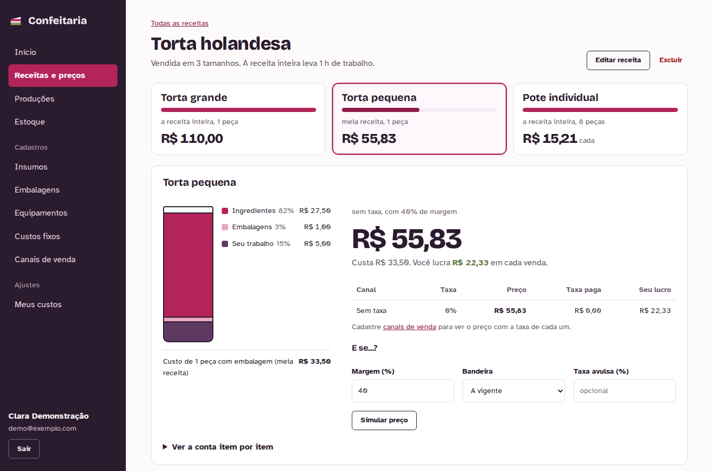
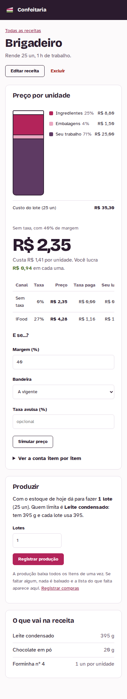

# Confeitaria API

API REST multiusuária para confeiteiras: calculadora de preço de venda (margem sobre o preço, por canal de venda,
com detalhamento de cada custo) e controle de estoque com histórico imutável.



**Stack:** Java 25 · Spring Boot 4.1 (Web MVC, Data JPA, Validation, Security + OAuth2 Resource Server) ·
PostgreSQL 17 · Flyway · springdoc-openapi 3 · JUnit 5, Mockito, Testcontainers 2 · Docker Compose.

## Como rodar

```bash
cp .env.example .env          # defina JWT_SECRET (>= 32 bytes) e a ADMIN inicial
docker compose up -d --build
open http://localhost:8080                    # aplicação web
open http://localhost:8080/swagger-ui.html   # documentação da API (botão Authorize aceita o access token)
```

Testes (unitários + integração com PostgreSQL em container; requer Docker):

```bash
mvn verify
```

| Variável | Padrão | Uso |
|---|---|---|
| `JWT_SECRET` | obrigatória | chave HMAC-SHA256 do access token |
| `JWT_ACCESS_TTL` / `JWT_REFRESH_TTL` | `15m` / `7d` | validade dos tokens |
| `DB_URL`, `DB_USER`, `DB_PASSWORD` | localhost/confeitaria | conexão PostgreSQL |
| `APP_ADMIN_EMAIL`, `APP_ADMIN_PASSWORD` | vazio | cria a primeira ADMIN na subida |
| `APP_DEMO_ENABLED` | `false` | cria a conta de demonstração `demo@exemplo.com` / `senha12345` com a torta holandesa em 3 tamanhos |

## Tamanhos de receita

A mesma receita pode virar produtos diferentes. Cada **tamanho** diz quanto da receita usa (`fracaoReceita`:
1 = inteira, 0,5 = meia), quantas peças rende e qual embalagem vai em cada peça. Ingredientes, trabalho, energia,
gás e custos fixos entram na proporção usada; a embalagem do tamanho entra uma vez por peça. O preço, a
simulação, a capacidade de produção e a baixa no estoque aceitam o tamanho.

A conta de demonstração traz a torta holandesa (receita inteira: R$ 55 de produtos, 1 h de trabalho a R$ 10/h,
margem de 40%, embalagem de R$ 1 por peça):

| Tamanho | Usa | Rende | Custo | Preço |
|---|---|---|---|---|
| Torta grande | a receita inteira | 1 torta | 55 + 10 + 1 = R$ 66,00 | **R$ 110,00** |
| Torta pequena | meia receita | 1 torta | 27,50 + 5 + 1 = R$ 33,50 | **R$ 55,83** |
| Pote individual | a receita inteira | 8 potes | (55 + 10) / 8 + 1 = R$ 9,125 cada | **R$ 15,21** cada |

O custo do pote aparece como R$ 9,12 (arredondamento `HALF_EVEN`), mas o preço usa o valor exato.

## Aplicação web

Em **http://localhost:8080** há uma interface em português para usar tudo sem Swagger: criar conta, configurar
custos, cadastrar insumos, embalagens, equipamentos, custos fixos e canais, montar receitas, ver o preço por
canal, simular margens, registrar compras, ajustes e produções, e acompanhar o estoque. A conta ADMIN vê só a
gestão de usuárias.

- **Sem build:** HTML, CSS e JavaScript (módulos ES) em `src/main/resources/static`, servidos pela própria API.
  Não há Node, bundler nem dependência de frontend.
- **Sessão:** o access token fica só em memória. O refresh token fica no `localStorage`, para a sessão sobreviver
  a um recarregamento. Um 401 dispara um único refresh, compartilhado entre as requisições em andamento.
- **Segurança:** todo texto vindo da API entra no DOM como texto, nunca como HTML. Uma Content-Security-Policy
  restrita (`script-src 'self'`) bloqueia scripts externos e inline.
- **A fatia:** a composição do custo do lote aparece como as camadas de uma fatia de bolo, cada uma com a altura
  proporcional ao seu peso no custo.



## Testar a API em 5 minutos (Swagger)

Com a stack no ar, abra **http://localhost:8080/swagger-ui.html** e siga os passos. Cada bloco é o corpo da
requisição; os ids vêm das respostas anteriores.

1. **Criar conta:** `POST /api/v1/auth/register`
   ```json
   { "nome": "Ana", "email": "ana@exemplo.com", "senha": "senha12345" }
   ```
2. **Entrar:** `POST /api/v1/auth/login` com e-mail e senha. Copie o `accessToken`, clique em **Authorize**
   (cadeado no topo) e cole o token. Ele vale 15 minutos; depois, use `POST /auth/refresh` com o `refreshToken`.
3. **Configurar custos:** `PUT /api/v1/configuracao`
   ```json
   { "salarioDesejadoMes": 4000, "horasTrabalhadasMes": 160, "bandeiraVigente": "VERDE",
     "criterioRateio": "HORAS", "permitirSaldoNegativo": false }
   ```
4. **Cadastrar insumos:** `POST /api/v1/insumos`, informando a embalagem como você compra:
   ```json
   { "nome": "Leite condensado", "unidade": "G", "quantidadeEmbalagem": 395, "precoEmbalagem": 7.90, "estoqueMinimo": 395 }
   ```
   ```json
   { "nome": "Chocolate em pó", "unidade": "G", "quantidadeEmbalagem": 200, "precoEmbalagem": 9.00, "estoqueMinimo": 0 }
   ```
5. **Cadastrar embalagem:** `POST /api/v1/embalagens`
   ```json
   { "nome": "Forminha nº 4", "custoUnitario": 0.06, "estoqueMinimo": 100 }
   ```
6. **Criar a receita:** `POST /api/v1/receitas`. O leite condensado e o chocolate são `POR_LOTE`. A forminha é
   `POR_UNIDADE`, ou seja, 1 por brigadeiro, 25 no lote.
   ```json
   { "nome": "Brigadeiro", "rendimento": 25, "tempoPreparoMin": 60, "margemLucro": 40,
     "insumos": [ { "insumoId": "<leite>", "quantidade": 395, "base": "POR_LOTE" },
                  { "insumoId": "<chocolate>", "quantidade": 20, "base": "POR_LOTE" } ],
     "embalagens": [ { "embalagemId": "<forminha>", "quantidade": 1, "base": "POR_UNIDADE" } ] }
   ```
7. **Ver o preço:** `GET /api/v1/receitas/{id}/preco`. O custo do lote é R$ 35,30 (insumos 8,80 + forminhas
   1,50 + 1 h de trabalho a R$ 25,00) e o custo unitário é R$ 1,41. Com 40% de margem, o preço é
   **R$ 2,35** (lucro de R$ 0,94). Cadastre um canal (`POST /api/v1/canais-venda`
   `{ "nome": "iFood", "taxaPercentual": 27 }`) e consulte de novo para ver o preço por canal.
   Para testar outras margens sem alterar a receita, use `POST /api/v1/receitas/{id}/simulacao` com `{ "margemLucro": 50 }`.
8. **Estoque e produção:** tente `POST /api/v1/producoes` com `{ "receitaId": "<receita>", "lotes": 1 }`. Sem
   estoque, a resposta é 422 com a lista `itensFaltantes`. Registre compras em `POST /api/v1/estoque/compras`:
   ```json
   { "insumoId": "<leite>", "quantidade": 790, "valorPago": 15.80 }
   ```
   (faça o mesmo para o chocolate e, com `embalagemId`, para as forminhas). Depois consulte
   `GET /api/v1/receitas/{id}/capacidade-producao`, produza de novo e confira as baixas em
   `GET /api/v1/estoque/movimentacoes`.

A ADMIN definida no `.env` entra pelo mesmo login e só acessa `/api/v1/admin/usuarios`.

## Arquitetura

**Camadas organizadas por feature** (`insumo`, `receita`, `estoque`...), cada uma com `api` (controllers + DTOs
em records), `application` (serviços transacionais) e `persistence` (entidades JPA + repositories).

As regras de negócio pesadas ficam em **domínio puro**, sem Spring nem JPA, testáveis com `new`:

- `precificacao.domain`: `CalculadoraPreco` recebe um snapshot imutável (`ParametrosPrecificacao`) e devolve
  `ResultadoPrecificacao`.
- `estoque.domain`: `PlanejadorBaixa`, `CalculadoraCapacidade`, `CalculadoraCustoMedio`.

Uma hexagonal completa traria ports/adapters para dezenas de CRUDs simples sem ganho real. O isolamento
fica onde ele paga: nos cálculos.

### Decisões

| Tema | Decisão |
|---|---|
| Multi-tenant | `owner_id` em toda tabela de negócio, e os repositories só buscam por `...AndOwnerId`. O dono vem do JWT (`@AuthenticationPrincipal UsuarioAutenticado`), nunca do request. Recurso alheio → **404**. |
| Perfis | `CONFEITEIRA` acessa `/api/v1/**` (só os próprios dados). `ADMIN` acessa só `/api/v1/admin/**` (gestão de contas, sem dados de negócio). |
| Preço sempre atual | O preço não é persistido, é recalculado a cada consulta. Mudou o custo de um insumo (edição ou compra), mudou o preço de todas as receitas que o usam. |
| Dinheiro e quantidades | `BigDecimal` em tudo, cálculo em escala 10 com `HALF_EVEN`, saída em 2 casas. `custo_unitario` em `NUMERIC(20,10)` porque o custo por grama é pequeno. |
| Unidades | Base `g`, `ml`, `un`. A API aceita `KG`/`L` e converte. |
| Itens da receita | `base`: `POR_LOTE` (quantidade para a receita inteira) ou `POR_UNIDADE` (multiplicada pelo rendimento). |
| Tamanhos | `receita_tamanho` (fração da receita, peças, embalagem por peça). O cálculo multiplica o lote pela fração; custos fixos por horas seguem a fração e por vendas contam cada peça. A produção guarda o nome do tamanho e as peças feitas, então editar a receita não muda o histórico. |
| Tarifas | Histórico com vigência (`tarifa_energia`, `adicional_bandeira`). Vale o registro com maior `vigencia_inicio` ≤ hoje (America/Sao_Paulo). VERDE sem cadastro = adicional zero. |
| Estoque | O saldo só muda por movimentação (`ENTRADA`, `SAIDA`, `AJUSTE`). O histórico é `@Immutable` e um trigger bloqueia UPDATE/DELETE. |
| Concorrência | `@Version` em insumo e embalagem. Compras, ajustes e produções rodam em `ExecutorComRetry` (até 5 tentativas com jitter) e, se esgotar, respondem **409**. |
| Erros | `@RestControllerAdvice` com `ProblemDetail` (RFC 9457), inclusive 401/403 do filtro de segurança. |

### Modelo de dados

```
usuario 1─N refresh_token
usuario 1─1 configuracao_custos          (salário, horas/mês, bandeira vigente, gás, critério de rateio, saldo negativo)
usuario 1─N tarifa_energia | adicional_bandeira                       (históricos com vigência)
usuario 1─N insumo | embalagem | equipamento | custo_fixo | canal_venda | receita | producao

receita 1─N receita_insumo      N─1 insumo        (quantidade na unidade base + base POR_LOTE/POR_UNIDADE)
receita 1─N receita_embalagem   N─1 embalagem     (quantidade + base)
receita 1─N receita_equipamento N─1 equipamento   (minutos de uso)
receita 1─N receita_tamanho     N─1 embalagem     (fração da receita, peças, embalagem por peça; opcional)
producao N─1 receita                              (nome do tamanho e peças produzidas guardados na produção)
movimentacao_estoque N─1 insumo XOR embalagem, N─1 producao (opcional)
```

### Pacotes

```
com.confeitaria
├── shared        config · security (JWT, SecurityConfig) · error (ProblemDetail) · domain (Decimais, unidades)
│                 persistence (ItemEstoque: base de insumo/embalagem com saldo e @Version) · api (PageResponse)
├── auth          login, cadastro, refresh com rotação, logout
├── usuario       /me e administração de usuárias
├── configuracao  custos da confeiteira, histórico de tarifa e bandeiras
├── insumo · embalagem · equipamento · custofixo · canalvenda · receita
├── precificacao  domain (puro) · application · api
├── estoque       domain (puro) · application (estoque, produção, retry) · persistence · api
└── demo          conta de demonstração (APP_DEMO_ENABLED)
```

## Autenticação

- `POST /auth/login` devolve um **access token JWT** (HS256, 15 min, claims `sub`=id, `email`, `perfil`) e um
  **refresh token opaco** (256 bits aleatórios). O banco guarda só o hash SHA-256 do refresh token.
- `POST /auth/refresh` **rotaciona**: revoga o token apresentado e emite um novo par. Se alguém reapresentar um
  refresh já revogado, a API entende como vazamento e revoga **todas** as sessões da usuária.
- `POST /auth/logout` revoga o refresh token. Desativar uma usuária (admin) também revoga os tokens dela.
- A validação do JWT é feita pelo resource server do Spring Security (`NimbusJwtDecoder` com validação de
  issuer e expiração), e um conversor transforma as claims em `UsuarioAutenticado`.

## Endpoints

Prefixo `/api/v1`. 🔓 público · 🔐 autenticado · 👩‍🍳 CONFEITEIRA · 🛡️ ADMIN. Listagens aceitam
`?page=&size=&sort=` (padrão 20, máximo 100). Exemplos completos de request/response estão no Swagger.

| | Método | Rota |
|---|---|---|
| 🔓 | POST | `/auth/register`, `/auth/login`, `/auth/refresh` |
| 🔐 | POST | `/auth/logout` |
| 🔐 | GET | `/me` |
| 🛡️ | GET · GET · PATCH | `/admin/usuarios?email=` · `/admin/usuarios/{id}` · `/admin/usuarios/{id}` (`ativo`, `perfil`) |
| 👩‍🍳 | GET · PUT | `/configuracao` |
| 👩‍🍳 | GET · POST · DELETE | `/configuracao/tarifas` · `/configuracao/tarifas` · `/configuracao/tarifas/{id}` |
| 👩‍🍳 | GET | `/configuracao/tarifas/vigente` |
| 👩‍🍳 | GET · POST · DELETE | `/configuracao/bandeiras?bandeira=` · `/configuracao/bandeiras` · `/configuracao/bandeiras/{id}` |
| 👩‍🍳 | GET | `/configuracao/bandeiras/vigentes` |
| 👩‍🍳 | CRUD | `/insumos`, `/embalagens`, `/equipamentos`, `/custos-fixos`, `/canais-venda`, `/receitas` |
| 👩‍🍳 | GET | `/receitas/{id}/preco?tamanhoId=` |
| 👩‍🍳 | POST | `/receitas/{id}/simulacao` (`margemLucro`, `bandeira`, `tarifaKwh`, `canalVendaId`, `taxaPercentual`, `tamanhoId`) |
| 👩‍🍳 | GET | `/receitas/{id}/capacidade-producao?tamanhoId=` |
| 👩‍🍳 | POST | `/estoque/compras`, `/estoque/ajustes` |
| 👩‍🍳 | GET | `/estoque/movimentacoes?tipo=&insumoId=&embalagemId=&de=&ate=` |
| 👩‍🍳 | GET | `/estoque/abaixo-minimo` |
| 👩‍🍳 | POST · GET · GET | `/producoes` (`receitaId`, `lotes`, `tamanhoId`) · `/producoes` · `/producoes/{id}` |

Exclusões de insumo, embalagem, equipamento e receita são lógicas (`ativo=false`). Excluir um item usado em
receita ativa (ou como embalagem de um tamanho) responde 409.

## Testes

| Suíte | O que cobre |
|---|---|
| `CalculadoraPrecoTest` | exemplo completo do bolo, margem × markup, taxas, `POR_UNIDADE`, rateio por horas/vendas, margem + taxa ≥ 100%, dados faltantes, HALF_EVEN, tamanhos (torta grande, pequena e pote) |
| `PlanejadorBaixaTest`, `CalculadoraCapacidadeTest`, `CalculadoraCustoMedioTest` | baixa proporcional, faltantes listados, saldo negativo opcional, itens repetidos, precisão, limites |
| `ProducaoServiceTest` (Mockito) | baixa + histórico, nada muda quando falta estoque, receita alheia → 404 |
| `IsolamentoEntreUsuariasIT` | toda leitura/escrita cruzada responde 404, listagens isoladas, perfis 401/403 |
| `AutenticacaoIT` | validação, login, rotação e detecção de reuso do refresh, logout, desativação pela admin |
| `FrontendIT` | página e arquivos estáticos públicos, demais caminhos e métodos continuam fechados |
| `FluxoBoloIT` | o [exemplo do bolo](docs/exemplo-bolo.md) inteiro pela API, mais o trigger de imutabilidade |
| `TortaHolandesaIT` | preço, simulação, capacidade e produção por tamanho; nomes repetidos, tamanho de outra receita, embalagem em uso; a conta de demonstração |
| `ConcorrenciaProducaoIT` | 20 produções simultâneas sobre estoque para 10 lotes: saldo consistente e nunca negativo |

## Exemplo

Veja o cálculo completo de um bolo, da embalagem do insumo ao preço por canal e à baixa no estoque, em
[docs/exemplo-bolo.md](docs/exemplo-bolo.md).
